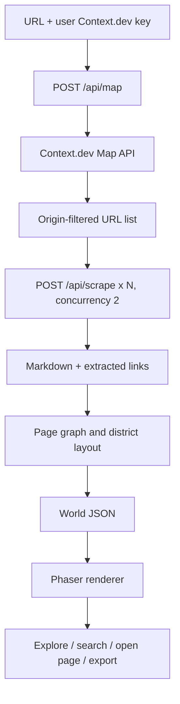

# Architecture

## Boundaries

- `api/` is the provider boundary and should not contain game-layout logic.
- `src/world.ts` converts normalized page records into a portable world JSON graph.
- `src/Game.tsx` renders the world and reports selected pages back to React.
- `src/App.tsx` owns UI state, progress, import/export, and user interactions.

## Future architecture options

For persistent worlds, add a database and auth. For automatic updates, store source URLs and a schedule, run a background worker, diff content, and regenerate only affected pages. Do not keep a user's provider key in a long-lived database unless there is a clear product need and a secure secrets design.
